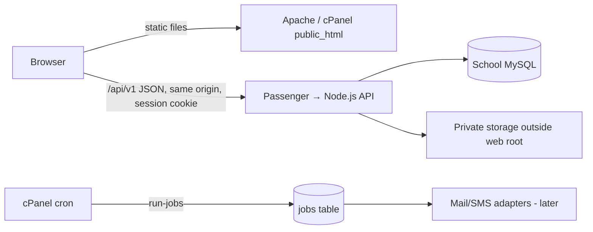

# Architecture

**Version:** 0.1.0 foundation · **Date:** 23 November 2026

This document describes how the code is organized today. Product scope lives in
[`school-management-blueprint.md`](school-management-blueprint.md); rules live in [`../instruction.md`](../instruction.md).

## 1. Shape of the system



- **One installation per school** (ADR-0001). No tenant id column: isolation is physical (separate DB and files).
  The `schools` table holds the single school this installation serves.
- **Modular monolith** API (ADR-0002) under a versioned prefix `/api/v1`.
- **Same-origin deployment**: the web app and API share a hostname so the session cookie can be
  `SameSite=Strict`, no CORS is needed, and CSRF exposure is minimal (ADR-0004).

## 2. Workspaces

| Package | Purpose | Build output |
|---|---|---|
| `packages/shared` | Roles → permissions map, error codes/shape, API prefix, locales, zod request schemas | `dist/` (ESM + .d.ts) |
| `apps/api` | Fastify API, migrations, CLIs (migrate, setup admin, run jobs) | `dist/` run by Node/Passenger |
| `apps/web` | React SPA, i18n, role-aware shell | `dist/` static files for Apache |

`shared` must stay dependency-light (only `zod`) and free of Node/DOM-specific code.

## 3. API internals (`apps/api/src`)

```
app.ts               buildApp(): plugins + versioned route registration (testable with inject)
server.ts            process entry (Passenger runs dist/server.js)
config/env.ts        zod-validated environment; refuses insecure production config
db/                  Kysely client, table types, migrator, migrations/ (static registry)
plugins/auth.ts      session cookie → req.auth; origin + CSRF checks; requireAuth / requirePermission
plugins/errors.ts    single error format (ApiErrorBody), zod → 422, no stack traces to clients
lib/                 audit, password (scrypt), tokens, AppError helpers
modules/<domain>/    routes.ts (+ service.ts) per domain: health, auth, school, academic, audit
jobs/                DB-backed queue, handlers registry, housekeeping
cli/                 migrate, create-admin (first-run), run-jobs (cron)
```

### Request pipeline

1. `onRequest` (auth plugin): reject cross-origin unsafe requests → load session by SHA-256 of the cookie
   token → if unsafe method, require `x-csrf-token` to equal the session's CSRF token.
2. Route `preHandler`: `requireAuth` or `requirePermission(...)` — coarse role gate.
3. Handler: zod-parse input → **record-scope check** → transaction → `recordAudit` → response.
4. Errors: throw `AppError('CODE', 'errors.key')`; the error plugin renders `{ error: { code, message, details, requestId } }`.

### Module pattern (copy `modules/academic/routes.ts`)

```ts
app.post('/things', { preHandler: requirePermission('things.manage') }, async (req, reply) => {
  const input = createThingSchema.parse(req.body);          // 1. validate
  await assertCanAccessClass(db, req.auth!, input.classId); // 2. scope (throws notFound())
  const id = await db.transaction().execute(async (trx) => { // 3. transaction
    const res = await trx.insertInto('things').values({...}).executeTakeFirstOrThrow();
    await recordAudit(trx, req, { action: 'thing.created', entityType: 'thing', entityId: Number(res.insertId) }); // 4. audit
    return Number(res.insertId);
  });
  return reply.status(201).send({ id });                    // 5. typed response
});
```

**Scope helpers** live next to their domain: `modules/people/scope.ts` has `studentScope(db, auth)` (a WHERE clause for
lists), `assertCanAccessStudent`, `canAccessClass` / `assertCanAccessClass` and `taughtSectionIds`. A student is in scope
when one of these holds — `students.read.all`; `students.read.scoped` and the user's staff profile teaches
(`teacher_assignments`) or is class teacher of a section the student is *currently* enrolled in; a guardian with a
**verified** `student_guardians` link; the student themself. Out of scope → `NOT_FOUND`.

### Authentication & sessions (ADR-0004)

- Passwords: Node built-in `scrypt` (N=2^17, r=8, p=1), parameters stored in the hash, transparent rehash on login.
- Sessions: random 256-bit token in an `HttpOnly; SameSite=Strict; Secure(prod)` cookie; only its SHA-256 is stored.
  Sliding expiry (`SESSION_TTL_MINUTES`). New session on every login.
- Throttling: per-identifier (5 failures / 15 min) and per-IP (30 / 15 min) from `login_attempts`, plus a
  route rate limit. Same error for unknown user, wrong password and disabled account.
- Permissions are derived from roles in code (`packages/shared/src/roles.ts`), not stored per user. Role grants are
  stored in `user_roles` and must be audited when changed.

### Data layer (ADR-0003)

- Kysely (typed SQL builder) + `mysql2`. Table types in `db/types.ts` must match migrations.
- Migrations are TypeScript, registered statically in `db/migrations/index.ts` so they run from `tsx` and from `dist/`.
- Requirements: InnoDB, `utf8mb4`, MySQL 8.0+ / MariaDB 10.6+ (needed for `SKIP LOCKED` and `CHECK`).
- Every pooled connection sets `default_storage_engine=InnoDB`, `time_zone='+00:00'` and a strict `sql_mode`
  (`db/client.ts`), so behaviour does not depend on host defaults (WAMP and some cPanel servers default to MyISAM
  and local time). Job `run_after` defaults to the database clock.
- Integration tests (`src/__integration__`, `npm run test:integration`) migrate an empty `*_test` database and check
  `db/types.ts` against `information_schema`; verified locally on MySQL 8.4 and MariaDB 11.4, and in CI on the
  minimums MySQL 8.0 / MariaDB 10.6.
- List endpoints use `paginationQuerySchema`, `pageWindow` and `toPaginated` from `@sms/shared`; dates use `isoDateSchema`.
- Store timestamps in UTC; school timezone (default `Asia/Colombo`) is applied at presentation.
- Marks (later): `DECIMAL`, never float; store max marks and grading-scale version with every mark.

### Background work (ADR-0005)

`jobs` table + `cli/run-jobs` from cPanel cron (e.g. every 5 minutes, 50-second budget). Handlers must be
idempotent; jobs retry with exponential backoff; stale `running` jobs are released after 15 minutes. Housekeeping
removes expired sessions and old login attempts.

## 4. Web internals (`apps/web/src`)

- `lib/api.ts` — same-origin fetch wrapper; adds CSRF header on unsafe methods; throws `ApiError` with the server code;
  `204` resolves to `undefined`.
- `lib/auth.tsx` — session context (`/auth/session` on load), `can(permission)` for UI hints only, `refresh()`,
  `signedOut` (explicit sign-out drops the return-to-page target so a shared device does not reopen the last user's page),
  `unreachable` + `retry()` (a network/server failure shows "can't reach the server" instead of looking like a sign-out).
- `lib/data.ts` — `useResource(path)` (GET + reload, abort-safe) and `useSubmit()` (busy state, translated error,
  per-field errors from `details`). `lib/format.ts` — locale-aware dates, relative times, calendar-date maths.
- `routes/` — `RequireAuth` (sign-in redirect with a return target; offline screen; forced password change while
  `mustChangePassword`), `RequirePermission` (hides screens outside the user's menu — UX only, the API enforces),
  `nav.ts` (menu grouped by area, icons, `soon` flag for unbuilt sections). `App.tsx` lazy-loads every page.
- `components/ui/` — design-system components: `Button`/`IconButton`, form controls (`Field`, `Input`, `PasswordInput`,
  `Select`, `Checkbox`, `RadioCard`, `FormSection`), feedback (`Alert`, `Badge`, `Skeleton`, `EmptyState`), layout
  (`PageHeader` with breadcrumbs, `Card`, `Tabs`, `Avatar`, `DescriptionList`), overlays (`Drawer` side sheet,
  `ConfirmDialog`, `DropdownMenu` — portalled, keyboard-navigable), `ToastProvider`/`useToast`, `DataTable` (sticky header,
  row click, row action menu, skeleton rows, phone card layout) and `Pagination`. `components/CrudSection.tsx` builds
  the academic setup tabs on these (quick filter, drawer forms, confirm-to-delete, toasts).
- Shell: collapsible icon sidebar (remembered per device) grouped by area; top bar with language picker and user menu;
  off-canvas menu on phones; skip link. Sign-in pages are split-screen with the school's name from the public
  `GET /school/branding` (name and short name only).
- Screens: dashboard (key numbers, current term progress, upcoming calendar events, setup checklist, quick actions —
  each part fetched only if the role allows it), sign in, reset password (`/#/reset-password[?token]`), accept invitation
  (`/#/accept-invite?token`), account, users & roles (table + drawer with Details / Roles / Sign-in & security tabs),
  academic setup (tab in `?tab=`), school settings (sectioned form + unsaved-changes bar).
- Visual system: neutral greys, one brand blue scale (`--color-brand-*` in `index.css` — the only thing to change to
  re-theme), semantic ok/warn/danger colours, 14px base type, system fonts (Noto fallbacks cover si/ta), Lucide icons
  (tree-shaken per icon). First load for an admin is ~123 kB gzipped; other screens load on demand.
- Bundle rule: the web app may import only zod-free modules from `@sms/shared` at runtime (`roles`, `locales`,
  `constants`, `api`); a test guards `constants.ts`. `npm run lint` also fails on literal `t('…')` keys missing from
  `en.json` (`scripts/check-i18n.mjs`).
- `i18n/` — i18next with `en` complete and `si`/`ta` falling back to English per key. API error messages are
  translation keys, so the UI translates them.
- `HashRouter` is used so the static build works on any host; switch to `BrowserRouter` once the `.htaccess`
  rewrite is confirmed on the target plan.

## 5. Current schema (migrations 0001–0011)

- **0001 foundation:** `schools`, `users`, `user_roles`, `sessions`, `login_attempts`, `audit_events`, `academic_years`,
  `terms`, `jobs`, `app_meta`, plus Kysely's `schema_migrations` tables.
- **0002 academic structure:** `grades`, `subjects` (optional `name_si`/`name_ta`), `grade_subjects`, `rooms`,
  `class_sections` (per year + grade, optional medium and home room), `period_definitions` (one bell schedule),
  `calendar_events` (holiday / term_break / exam / event, `is_school_day`).
- **0004:** `user_tokens`, `users.must_change_password`.
- **0005 people:** `staff_profiles`, `student_profiles`, `student_status_events`, `enrollments`, `guardian_profiles`,
  `student_guardians`, `teacher_assignments`, `class_sections.class_teacher_id`, `import_jobs`.
- **0006 attendance:** `attendance_sessions` (unique per section + date), `attendance_records`, `attendance_corrections`.
- **0007:** `timetable_entries` (clash keys), `announcements`, `announcement_reads`.
- **0008 learning:** `stored_files`, `learning_items`, `learning_item_files`, `submissions`, `submission_files`.
- **0009 question bank:** `questions`, `question_versions`, `exam_papers`, `exam_paper_versions`, `exam_paper_items`.
- **0010 exams:** `grading_scales`, `grading_scale_versions`, `exam_series`, `exam_components`, `mark_sheets`, `marks`,
  `mark_changes`, `result_releases`.
- **0011 certificates:** `certificate_templates`, `certificates`.
- **0003:** adds 0001's foreign keys. 0001 declared them inline (`.references()`), which **MySQL silently ignores**
  (MariaDB honours them, so 0003 skips existing keys). Always use `.addForeignKeyConstraint()`; ESLint rejects
  `.references()` in migrations and a schema test fails if any `*_id`/`*_by` column lacks a foreign key.

Deletes are `RESTRICT` while referenced and surface as `409 errors.inUse`; the error plugin maps MySQL/MariaDB
duplicate / in-use / bad-reference / check errors (`fromDbError`) so races still produce clean API errors.

### Academic structure API (`modules/academic/`)

| Resource | Endpoints | Rules |
|---|---|---|
| Academic years | `GET/POST /academic-years`, `GET/PATCH/DELETE /academic-years/:id`, `POST /academic-years/:id/current` | Unique label; one current year; dates cannot shrink past its terms/events |
| Terms | `GET/POST /academic-years/:id/terms`, `PATCH/DELETE /terms/:id` | Inside the year; no overlap; unique sequence (year row locked while checking) |
| Grades | `GET/POST /grades`, `PATCH/DELETE /grades/:id`, `GET/PUT /grades/:id/subjects` | Unique name and level; PUT replaces the subject list |
| Subjects, rooms | `GET/POST /subjects`, `PATCH/DELETE /subjects/:id`; same for `/rooms` | Unique code / name; retire with `isActive: false` |
| Class sections | `GET /class-sections?academicYearId&gradeId`, `POST`, `GET/PATCH/DELETE /class-sections/:id` | Unique per year+grade; active grade and room only; year/grade fixed after creation |
| Periods | `GET/POST /periods`, `PATCH/DELETE /periods/:id` | `HH:MM`; no overlapping times; unique sequence |
| Calendar | `GET /calendar-events?from&to&academicYearId`, `POST`, `PATCH/DELETE /calendar-events/:id` | Inside its year when linked; inclusive dates |
| Year rollover | `POST /academic-years/:id/rollover` `{ fromAcademicYearId, dryRun }` | Copies class sections (name, grade, medium, capacity; home room only if still active) from another year; skips existing (grade + name) and retired grades, so re-running is safe; `dryRun` previews. Subjects are per grade, so nothing else to copy; students are not promoted |

Reads need `academic.structure.read`, writes `academic.structure.manage`. Every write is audited in the same transaction
with field names only. Deletes return `204`. Request schemas live in `@sms/shared` (`schemas/academic.ts`).

### Users, roles and passwords (`modules/users/`, `modules/auth/`, migration 0004)

| Endpoint | Permission | Notes |
|---|---|---|
| `GET /users?q&role&status&page&pageSize`, `GET /users/:id` | `users.read` | Search escapes LIKE wildcards |
| `POST /users` (`onboarding: invite \| temporary_password`) | `users.manage` (+ `roles.assign` if roles given) | Invite needs an email identifier |
| `PATCH /users/:id`, `POST /users/:id/disable \| enable \| invitation \| temporary-password` | `users.manage` | Disable ends sessions and links; cannot disable self |
| `PUT /users/:id/roles` | `roles.assign` | One audit entry per granted/revoked role |
| `POST /auth/password` | signed in | Keeps this session, ends the others |
| `POST /auth/password-reset/request \| confirm`, `POST /auth/invitations/accept` | public, rate-limited | Request always returns 202; max 3 reset requests per account per hour |

- **Last administrator:** the last active `school_admin` cannot be disabled or lose the role (grants are locked
  `FOR UPDATE` while checking).
- **Temporary passwords** set `must_change_password`; until changed, every guard returns `403 PASSWORD_CHANGE_REQUIRED`
  except routes marked `config.allowDuringPasswordChange` (session, password change, logout).
- **One-time links** (`user_tokens`): the request stores a *pending* row; the `user_token.send` job mints the token,
  stores only its SHA-256 and real expiry (invite 72 h, reset 1 h), and emails `APP_ORIGIN/#/…?token=`. The raw token is
  never in the database, job payloads, logs or audit. Newer requests, password changes and disabling mark older links
  used. Mail adapters: `file` (dev outbox under `STORAGE_DIR/outbox`) and `smtp` (nodemailer).
- Public routes skip the session CSRF token (they never act on the session) but keep the Origin check.

### Audit log and system status

- `GET /audit-events` (audit.read): newest first; filters `category` (prefix groups in `AUDIT_CATEGORIES`, shared with the web),
  `action`, `q` (person name/identifier), `actorUserId`, `entityType`+`entityId`, `from`/`to` (ISO times; the browser sends local
  day bounds). Items carry the actor, record, metadata (field names/ids only), IP and request id. A test fails if an audited
  action fits no category. Labels live in `en.json` under `audit.actions` (dots → underscores; raw code as fallback).
- `GET /ops/status` (ops.status.read) adds `jobsOverdue` (pending jobs >15 min past due ⇒ the cron job is not running),
  `mailTransport`, `environment`, `serverTime`, `lastBackup`, `lastRestore`. The status screen turns these into a
  "needs attention" list with the fix for each (no backup / stale >26 h, overdue or failed jobs, email off in production).

### Backup and restore (`src/backup/`, CLIs `backup`, `verify-backup`, `restore`)

- Pure Node (no `mysqldump` needed on cPanel). One consistent snapshot (`START TRANSACTION WITH CONSISTENT SNAPSHOT`) of every
  table except sessions, user_tokens, login_attempts, jobs and Kysely's migration tables, plus `STORAGE_DIR` minus `outbox/`.
- Container: `SMSBAK/1` + authenticated JSON header + AES-256-GCM(gzip(JSON lines)) + tag; key = scrypt(`BACKUP_PASSPHRASE`).
  Written as `.partial` then renamed; `app_meta.last_backup_*` + audit `backup.created`; keeps `BACKUP_KEEP` newest.
- Restore: empty database only → decrypt to a private temp file and verify everything (counts, file hashes) → refuse a
  newer-release backup → migrate to the backup's schema → load rows in one transaction (FK checks off) → check counts →
  migrate to latest → move files into place → audit `backup.restored`. `GET /ops/status` reports `lastBackup`/`lastRestore`.
- Runbook and rehearsal: [backup-restore.md](backup-restore.md).

### Releases (`scripts/release/`, `src/release/`)

- `npm run release` bundles the API with esbuild (ESM, code-split, createRequire banner) into `api/server.js` + `api/cli/*.js`
  — no node_modules on the server — plus `web/`, `docs/` and `release.json`; tars it and writes a manifest (version,
  migrations, Node range, archive + per-file SHA-256, key id) signed with Ed25519. Refuses dirty trees (signed), version
  mismatches and private keys inside the repo.
- Trust: `TRUSTED_RELEASE_KEYS` compiled into each release (empty until the product team generates its key); a first
  install may pass `--public-key` after an out-of-band fingerprint check. `verify-release` checks signature, archive and
  extracted files; `upgrade-check` refuses a database newer than the release, stale/missing backups and old Node.
- Guide: [upgrade.md](upgrade.md).

### People (`modules/people/`, migration 0005)

Field set is minimal and **provisional until the data policy (P0-6)** is signed off: no national ID, address, health,
religion or ethnicity columns.

| Resource | Endpoints | Permission / rules |
|---|---|---|
| Students | `GET /students?q&status&classSectionId&gradeId&academicYearId&unenrolled`, `GET /students/:id`, `POST`, `PATCH /students/:id` | Read: `students.read.all` or `.scoped` (+ scope). Write: `students.manage`. Detail view is audited (`student.viewed`); status history and guardians only for read.all/manage |
| Leaving | `POST /students/:id/leave` `{status, effectiveOn, reason, note}`, `POST /students/:id/readmit` | Ends the open enrolment; reason code in audit, free-text note only in `student_status_events` |
| Enrolment | `POST /students/:id/enrollments`, `PATCH /enrollments/:id`, `POST /enrollments/promote`, `GET /class-sections/:id/students` | One open enrolment per student (student row locked); moving closes the old one the day before (never after its year ends); start date inside the section's year |
| Staff | `GET/POST /staff`, `GET/PATCH /staff/:id` | `staff.read` / `staff.manage`; optional 1:1 link to a user account (audited) |
| Guardians | `GET/POST /guardians`, `GET/PATCH/DELETE /guardians/:id`; links `POST /students/:id/guardians`, `PATCH/DELETE …/:guardianId`, `POST …/:guardianId/verify`; queue `GET /guardian-links?status` | `guardians.link.manage` (registrar). Links start `pending`; only `verified` grants access; verification records who/when/method |
| Assignments | `GET/POST /teacher-assignments`, `DELETE /teacher-assignments/:id`, `PUT /class-sections/:id/class-teacher`, `GET /me/teaching` | `academic.structure.read` / `.manage`; subject must be in the grade's subject list. These rows are the teacher's scope |
| CSV import | `POST /imports` (preview), `POST /imports/:id/apply`, `GET /imports`, `GET /imports/:id` | Kind-specific permission. Preview runs the real import in a rolled-back transaction; apply re-sends the file (SHA-256 must match), refuses rows with errors and files already applied. CSV content is never stored; row errors hold line/column/message only |

Web: Students (list + drawer with details, classes, guardians, history; promote a class), Staff (drawer with teaching
assignments and class teacher), Guardians (verification queue + directory), Import data (template download, preview, apply).

### Attendance (`modules/attendance/`, migration 0006)

| Endpoint | Rules |
|---|---|
| `GET/PUT /class-sections/:id/attendance/:date` | Roster = students enrolled on that date. Take: `attendance.record.scoped` for taught/class-teacher sections, or `attendance.correct`. No future dates, dates outside the section's year, or calendar closures (`409 errors.notSchoolDay`). Editable only on the day itself (school time zone); `attendance.correct` may catch up a register nobody took |
| `GET /class-sections/:id/attendance?from&to` | Per-student totals and attendance rate (present + late ÷ marked) |
| `GET /me/attendance-registers?date` | Sections the user can take on that date, with taken/not-taken |
| `POST /attendance/corrections`, `GET /attendance/corrections?status`, `POST /attendance/corrections/:id/decide` | After the day, changes are corrections with a reason. Requests by `attendance.correct` apply at once (recorded as approved by themselves); others wait for approval. Reasons live in `attendance_corrections` only |

Newly absent students queue `attendance.absence_notice` (idempotency key per student and day; 30-minute delay so quick
corrections cancel it; moved out of 20:00–07:00 school time). The job re-checks the record and emails verified guardians
with `notify_email` and an email address. Per-period registers and SMS are not built yet.

### Timetable and announcements (`modules/timetable/`, `modules/announcements/`, migration 0007)

- **Timetable** — `GET /timetable?classSectionId|staffId|roomId&academicYearId`, `GET /me/timetable`, `POST/PATCH/DELETE
  /timetable-entries`. Read: `timetable.read`; change: `timetable.manage`. Lessons only in non-break periods, only subjects
  the grade takes, only teachers assigned to that class and subject. Clashes are refused with `errors.timetableClassBusy` /
  `TeacherBusy` / `RoomBusy`; unique keys (class/teacher/room × day × period, per year) back this up.
- **Announcements** — feed `GET /announcements` (with `unread` count), `POST /announcements/:id/read`; publisher
  `GET /announcements/manage`, `POST /announcements`, `PUT /announcements/:id` (drafts only), `/publish`, `/withdraw`,
  `DELETE` (drafts only). Audiences: school, role, grade, class, guardians of a class. Grade/class audiences reach students
  enrolled now, their **verified** guardians, and staff who teach there. Published text is never rewritten — withdraw instead.

### Learning and files (`modules/learning/`, `lib/files.ts`, migration 0008)

- **Files** — `POST /files?name=` (raw `application/octet-stream`, 10 MB), `GET /files/:id`. Stored under
  `STORAGE_DIR/files/xx/<random>.bin` (outside the web root, included in backups). Type is sniffed from the bytes against
  an allow-list (PDF, PNG, JPEG, WebP, OOXML/ODF by extension inside ZIP, UTF-8 text); HTML/SVG/executables are refused.
  Downloads send `attachment`, `nosniff`, `no-store`. A file is readable only via what it is attached to (or by its uploader
  while unattached); downloads of student work are audited. Cron housekeeping deletes files unattached for a day.
- **Items** — `GET/POST /learning-items`, `GET/PUT/DELETE /learning-items/:id`, `POST /learning-items/:id/publish`. Kinds:
  `resource`, `assignment` (due date, late policy, max score). Manage: `learning.manage.all` (coordinator) or
  `learning.manage.scoped` with a teacher assignment for that class + subject. Read: those, `learning.read.all`
  (principal), class teachers, and with `learning.read.own` students enrolled now / verified guardians (published only).
- **Submissions** — `POST /learning-items/:id/submission` (the student; resubmit replaces until returned; late flag; refused
  after the due date when late work is off), `GET /learning-items/:id/submissions` (roster view), `POST /submissions/:id/return`
  (feedback + score ≤ max). `GET /me/children` lists a guardian's verified children (or the student themself).
- New permissions (roles.ts): `learning.manage.scoped` (teacher), `learning.manage.all` + `learning.read.all`
  (academic coordinator), `learning.read.all` (principal), `learning.read.own` (student, guardian) — part of the
  permission-matrix sign-off (P0).

### Question bank and exam papers (`modules/questions/`, migration 0009)

- `GET/POST /questions`, `GET /questions/:id`, `POST /questions/:id/versions` (edit = new draft version),
  `/submit-review`, `/review` (`questions.review`, per version), `/retire`.
- `GET/POST /papers`, `GET /papers/:id`, `PUT /papers/:id/draft`, `POST /papers/:id/finalize`,
  `GET /paper-versions/:id?answers=false` (printable without the answer key).
- Authors (`questions.author`, teachers) are limited to subjects they teach; reviewers (`questions.review`, coordinator)
  see all. Papers hold exact **approved** question versions; a `final` version is frozen and changing it starts a new
  draft version, so a paper already sat never changes.

### Exams, marks and results (`modules/exams/`, migration 0010)

| Step | Endpoints | Who / rules |
|---|---|---|
| Setup | `GET/POST /grading-scales`, `POST /grading-scales/:id/versions`, `GET/POST /exam-series`, `GET /exam-series/:id`, `POST /exam-series/:id/components`, `DELETE /exam-components/:id` | `exams.manage` (coordinator). Scale changes are new versions; a series pins its scale version. Components: grade × subject × paper with max marks and weight; may link a **final** paper version |
| Marks | `GET /exam-components/:id/sheets/:classSectionId`, `PUT …/marks` | Teachers (`marks.enter.scoped`) for assigned class + subject while the sheet is `open`. DECIMAL raw marks, `present/absent/exempt`, ≤ max (DB check too), max and assessor stored with each mark. After submission only moderators change marks, with a reason → `mark_changes` |
| Workflow | `POST …/actions {submit\|moderate\|approve\|reopen}` | open → submitted (all students marked) → moderated (`marks.moderate`) → approved (`results.approve`). Reopen needs a reason (kept on the sheet, not in audit) |
| Results | `GET /exam-series/:id/classes/:classSectionId/results`, `POST /exam-series/:id/releases`, `GET /result-releases/:id` | `calculate.ts` (pure, unit-tested): weighted subject %, band grade, total, average, competition rank. Publishing (`results.publish`) needs every sheet approved and **appends** an immutable JSON snapshot (+SHA-256); version > 1 requires a reason. Nothing overwrites a release |
| Family | `GET /me/results?studentId` | `results.read.own`: the student or a verified guardian; latest release per series; only that student's row plus class size. Audited as `results.viewed` |

The default calculation rules are documented in `calculate.ts` and must be confirmed against the pilot school's sheets (P0-3).

### Family portal and onboarding (`people/onboarding.ts`, `/me/*`)

- `GET /me/children` (verified children, or the student themself), `GET /me/attendance?studentId&from&to`,
  `GET /me/timetable?studentId`, `GET /me/results?studentId`, and learning items with `?studentId`. All go through
  `resolveFamilyStudent` — the student themself or a **verified** guardian — and return `NOT_FOUND` for anyone else's child.
  Staff record endpoints (`/students/:id`) stay closed to families.
- `POST /guardians/:id/invite` (registrar): guardian-only account, needs an email and a verified link, sends an invitation.
  `POST /students/:id/account` (registrar): student-only account with a school username and a temporary password.
  Existing accounts are never taken over (409).
- Web: students and guardians get a home with attendance (30 days), today's lessons, work due, notices and released
  results, with a child switcher; teachers get today's registers and lessons on top of the staff dashboard.

### Certificates (`modules/certificates/`, migration 0011)

- Templates per language with placeholders (`{{student_name}}`, `{{name_with_initials}}`, `{{admission_no}}`, `{{class}}`,
  `{{issued_on}}`, `{{details}}`, `{{school}}`). Issuing (`certificates.issue`: registrar, principal) renders and **freezes**
  title and body on the certificate; later template edits never change it.
- Serial `<SCHOOL>-<YEAR>-<6 digits>-<4 random>`, unique. Revoke (`certificates.revoke`: principal) keeps the row with
  who/when/why (reason not in audit).
- Public check `GET /public/certificates/:serial` (no sign-in, 30/min): validity, title, holder's name (with initials),
  issue/revoke date, school — nothing else. Web: `/#/verify?serial=`. Printing: `/#/print/certificate/:id` (full page; the
  browser's "Save as PDF" gives a PDF). No server-side PDF generation yet.
- Families: `GET /me/certificates?studentId`, `GET /certificates/:id` (holder or verified guardian).

## 6. Known gaps (tracked in backlog.md)

- Field-level validation messages from the API are English validator text (translation keys only for business rules).
- No MFA, maintenance mode or in-app update client yet; no real release signing key generated yet; no admin-screen download of backups. The sidebar school name refreshes on the next page load after
  editing settings.
- Email templates are English only; si/ta fall back to English.
- The reset-request endpoint does a little more work for real accounts than unknown ones, so response timing may
  differ slightly; the body and status are identical, and requests are rate-limited.
- si/ta translations are not supplied yet (only language names).
- Hosting compatibility is not validated on a real cPanel plan.
