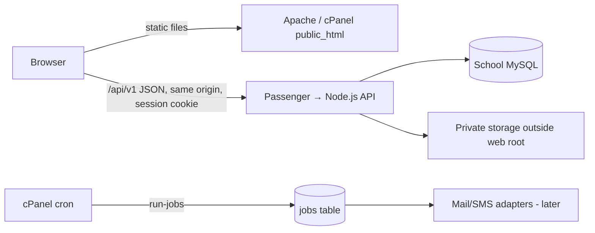

# Architecture

**Version:** 0.1.0 foundation · **Date:** 23 November 2026

This document describes how the code is organized today. Product scope lives in
[`school-management-blueprint.md`](school-management-blueprint.md); rules live in [`../instruction.md`](../instruction.md).

## 1. Shape of the system



- **One installation per school** (ADR-0001). No tenant id column: isolation is physical (separate DB and files).
  The `schools` table holds the single school this installation serves.
- **Modular monolith** API (ADR-0002) under a versioned prefix `/api/v1`.
- **Same-origin deployment**: the web app and API share a hostname so the session cookie can be
  `SameSite=Strict`, no CORS is needed, and CSRF exposure is minimal (ADR-0004).

## 2. Workspaces

| Package | Purpose | Build output |
|---|---|---|
| `packages/shared` | Roles → permissions map, error codes/shape, API prefix, locales, zod request schemas | `dist/` (ESM + .d.ts) |
| `apps/api` | Fastify API, migrations, CLIs (migrate, setup admin, run jobs) | `dist/` run by Node/Passenger |
| `apps/web` | React SPA, i18n, role-aware shell | `dist/` static files for Apache |

`shared` must stay dependency-light (only `zod`) and free of Node/DOM-specific code.

## 3. API internals (`apps/api/src`)

```
app.ts               buildApp(): plugins + versioned route registration (testable with inject)
server.ts            process entry (Passenger runs dist/server.js)
config/env.ts        zod-validated environment; refuses insecure production config
db/                  Kysely client, table types, migrator, migrations/ (static registry)
plugins/auth.ts      session cookie → req.auth; origin + CSRF checks; requireAuth / requirePermission
plugins/errors.ts    single error format (ApiErrorBody), zod → 422, no stack traces to clients
lib/                 audit, password (scrypt), tokens, AppError helpers
modules/<domain>/    routes.ts (+ service.ts) per domain: health, auth, school, academic, audit
jobs/                DB-backed queue, handlers registry, housekeeping
cli/                 migrate, create-admin (first-run), run-jobs (cron)
```

### Request pipeline

1. `onRequest` (auth plugin): reject cross-origin unsafe requests → load session by SHA-256 of the cookie
   token → if unsafe method, require `x-csrf-token` to equal the session's CSRF token.
2. Route `preHandler`: `requireAuth` or `requirePermission(...)` — coarse role gate.
3. Handler: zod-parse input → **record-scope check** → transaction → `recordAudit` → response.
4. Errors: throw `AppError('CODE', 'errors.key')`; the error plugin renders `{ error: { code, message, details, requestId } }`.

### Module pattern (copy `modules/academic/routes.ts`)

```ts
app.post('/things', { preHandler: requirePermission('things.manage') }, async (req, reply) => {
  const input = createThingSchema.parse(req.body);          // 1. validate
  await assertCanAccessClass(db, req.auth!, input.classId); // 2. scope (throws notFound())
  const id = await db.transaction().execute(async (trx) => { // 3. transaction
    const res = await trx.insertInto('things').values({...}).executeTakeFirstOrThrow();
    await recordAudit(trx, req, { action: 'thing.created', entityType: 'thing', entityId: Number(res.insertId) }); // 4. audit
    return Number(res.insertId);
  });
  return reply.status(201).send({ id });                    // 5. typed response
});
```

**Scope helpers** (to be added with the people/class modules) live next to their domain, e.g.
`modules/people/scope.ts` with `assertCanAccessStudent(db, auth, studentId)` that checks: same installation
(implicit), and one of — `students.read.all`; teacher assigned to the student's current class/subject;
guardian with a verified `student_guardians` link; the student themself.

### Authentication & sessions (ADR-0004)

- Passwords: Node built-in `scrypt` (N=2^17, r=8, p=1), parameters stored in the hash, transparent rehash on login.
- Sessions: random 256-bit token in an `HttpOnly; SameSite=Strict; Secure(prod)` cookie; only its SHA-256 is stored.
  Sliding expiry (`SESSION_TTL_MINUTES`). New session on every login.
- Throttling: per-identifier (5 failures / 15 min) and per-IP (30 / 15 min) from `login_attempts`, plus a
  route rate limit. Same error for unknown user, wrong password and disabled account.
- Permissions are derived from roles in code (`packages/shared/src/roles.ts`), not stored per user. Role grants are
  stored in `user_roles` and must be audited when changed.

### Data layer (ADR-0003)

- Kysely (typed SQL builder) + `mysql2`. Table types in `db/types.ts` must match migrations.
- Migrations are TypeScript, registered statically in `db/migrations/index.ts` so they run from `tsx` and from `dist/`.
- Requirements: InnoDB, `utf8mb4`, MySQL 8.0+ / MariaDB 10.6+ (needed for `SKIP LOCKED` and `CHECK`).
- Every pooled connection sets `default_storage_engine=InnoDB`, `time_zone='+00:00'` and a strict `sql_mode`
  (`db/client.ts`), so behaviour does not depend on host defaults (WAMP and some cPanel servers default to MyISAM
  and local time). Job `run_after` defaults to the database clock.
- Integration tests (`src/__integration__`, `npm run test:integration`) migrate an empty `*_test` database and check
  `db/types.ts` against `information_schema`; verified locally on MySQL 8.4 and MariaDB 11.4, and in CI on the
  minimums MySQL 8.0 / MariaDB 10.6.
- List endpoints use `paginationQuerySchema`, `pageWindow` and `toPaginated` from `@sms/shared`; dates use `isoDateSchema`.
- Store timestamps in UTC; school timezone (default `Asia/Colombo`) is applied at presentation.
- Marks (later): `DECIMAL`, never float; store max marks and grading-scale version with every mark.

### Background work (ADR-0005)

`jobs` table + `cli/run-jobs` from cPanel cron (e.g. every 5 minutes, 50-second budget). Handlers must be
idempotent; jobs retry with exponential backoff; stale `running` jobs are released after 15 minutes. Housekeeping
removes expired sessions and old login attempts.

## 4. Web internals (`apps/web/src`)

- `lib/api.ts` — same-origin fetch wrapper; adds CSRF header on unsafe methods; throws `ApiError` with the server code.
- `lib/auth.tsx` — session context (`/auth/session` on load), `can(permission)` for UI hints only.
- `routes/nav.ts` — role-aware navigation config; `App.tsx` lazy-loads pages.
- `i18n/` — i18next with `en` complete and `si`/`ta` falling back to English per key. API error messages are
  translation keys, so the UI translates them.
- `HashRouter` is used so the static build works on any host; switch to `BrowserRouter` once the `.htaccess`
  rewrite is confirmed on the target plan.

## 5. Current schema (migrations 0001–0003)

- **0001 foundation:** `schools`, `users`, `user_roles`, `sessions`, `login_attempts`, `audit_events`, `academic_years`,
  `terms`, `jobs`, `app_meta`, plus Kysely's `schema_migrations` tables.
- **0002 academic structure:** `grades`, `subjects` (optional `name_si`/`name_ta`), `grade_subjects`, `rooms`,
  `class_sections` (per year + grade, optional medium and home room), `period_definitions` (one bell schedule),
  `calendar_events` (holiday / term_break / exam / event, `is_school_day`).
- **0003:** adds 0001's foreign keys. 0001 declared them inline (`.references()`), which **MySQL silently ignores**
  (MariaDB honours them, so 0003 skips existing keys). Always use `.addForeignKeyConstraint()`; ESLint rejects
  `.references()` in migrations and a schema test fails if any `*_id`/`*_by` column lacks a foreign key.

Deletes are `RESTRICT` while referenced and surface as `409 errors.inUse`; the error plugin maps MySQL/MariaDB
duplicate / in-use / bad-reference / check errors (`fromDbError`) so races still produce clean API errors.

### Academic structure API (`modules/academic/`)

| Resource | Endpoints | Rules |
|---|---|---|
| Academic years | `GET/POST /academic-years`, `GET/PATCH/DELETE /academic-years/:id`, `POST /academic-years/:id/current` | Unique label; one current year; dates cannot shrink past its terms/events |
| Terms | `GET/POST /academic-years/:id/terms`, `PATCH/DELETE /terms/:id` | Inside the year; no overlap; unique sequence (year row locked while checking) |
| Grades | `GET/POST /grades`, `PATCH/DELETE /grades/:id`, `GET/PUT /grades/:id/subjects` | Unique name and level; PUT replaces the subject list |
| Subjects, rooms | `GET/POST /subjects`, `PATCH/DELETE /subjects/:id`; same for `/rooms` | Unique code / name; retire with `isActive: false` |
| Class sections | `GET /class-sections?academicYearId&gradeId`, `POST`, `GET/PATCH/DELETE /class-sections/:id` | Unique per year+grade; active grade and room only; year/grade fixed after creation |
| Periods | `GET/POST /periods`, `PATCH/DELETE /periods/:id` | `HH:MM`; no overlapping times; unique sequence |
| Calendar | `GET /calendar-events?from&to&academicYearId`, `POST`, `PATCH/DELETE /calendar-events/:id` | Inside its year when linked; inclusive dates |

Reads need `academic.structure.read`, writes `academic.structure.manage`. Every write is audited in the same transaction
with field names only. Deletes return `204`. Request schemas live in `@sms/shared` (`schemas/academic.ts`).

## 6. Known gaps (tracked in backlog.md)

- CI workflow exists (`.github/workflows/ci.yml`) but has not run yet: the repository has no GitHub remote.
- No password reset, user management UI, MFA, backup/restore tooling or update client yet.
- si/ta translations are not supplied yet (only language names).
- Hosting compatibility is not validated on a real cPanel plan.
