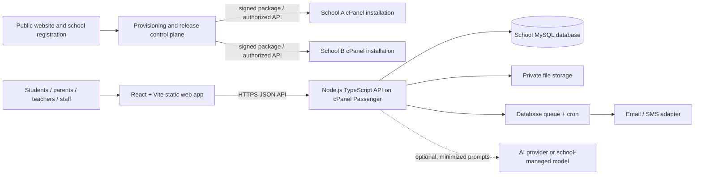

# Sri Lanka School Management System — Product and Architecture Blueprint

**Status:** Initial architecture blueprint  
**Date:** 23 November 2026  
**Audience:** Product, engineering, school leadership, and hosting operations

## 1. Executive recommendation

Build a multi-school product whose **school runtime is a self-contained, installable application**. Treat the public marketing/registration site and the school product as two related but independently deployable parts.

For the target of broad cPanel compatibility, use:

- **School UI:** React + TypeScript + Vite + Tailwind CSS, built to static assets.
- **School API:** Node.js with TypeScript and a lightweight HTTP framework such as Fastify, deployed under cPanel Application Manager/Phusion Passenger where enabled. Use a MySQL-compatible ORM/query layer with versioned migrations.
- **Database:** MySQL/MariaDB supported by the selected host.
- **Jobs:** database-backed queue and cPanel cron for scheduled work; avoid requiring Redis. The API itself needs a persistent Node.js process managed by Passenger or an equivalent service.
- **Files:** local private storage outside the public web root where possible; optional S3-compatible object storage later.
- **Optional cloud services:** central licensing/update metadata, email/SMS gateways, and AI provider integrations. The core school system must remain usable if these are unavailable.

The user-listed technologies include React, Next.js, Vite, MySQL, Tailwind, TypeScript, JavaScript, and HTML. **Do not use both Next.js and Vite for the same school UI.** Vite is a lightweight client build, but the school API still requires a running Node.js server. cPanel supports Passenger-based Node.js apps through Application Manager only when the hosting provider enables the required runtime and feature ([cPanel Application Manager requirements](https://docs.cpanel.net/cpanel/software/application-manager/)). Therefore, qualify target cPanel plans before promising installation. Use an actively supported Node.js LTS release that the provider supports; Node.js recommends production applications use Active or Maintenance LTS releases ([Node.js release schedule](https://nodejs.org/en/about/previous-releases)). Next.js may be used for a public website if justified and the host supports its deployment mode; it is not required for the school UI ([Next.js deployment guide](https://nextjs.org/docs/app/getting-started/deploying)).

A shared cPanel account is suitable for a pilot or a small school with modest use, subject to the provider's limits. It is not a reliable universal target for every school size. Publish a host compatibility checklist and recommend VPS/managed hosting once a school exceeds tested limits.

## 2. Product model and deployment boundary

### 2.1 Product surfaces

1. **Main public website:** product information, school directory/landing pages as desired, demo, pricing, support, registration, and onboarding status.
2. **School application:** each school receives its own installation, domain/subdomain, database, files, credentials, and backups.
3. **Central operations service:** optional small control plane for tenant registration, entitlements, signed release metadata, support status, and deployment orchestration where authorized.

The school application must not require the central service for login, attendance, teaching, exams, marks, reports, or certificate verification. This reduces outage and vendor lock-in risk.

### 2.2 Isolation choice

For the initial launch, use **one database and deployment per school**. This best matches the requirement that schools operate their own installation and gives clear data ownership, restore, and offboarding boundaries. It costs more to operate than a shared multi-tenant database but reduces cross-school data-leak risk and simplifies school-specific backups.

Do not implement a single shared database with a tenant ID as the first release. Consider it only as a later hosted offering with rigorously tested tenant isolation, access controls, and operational tooling.

### 2.3 What “single click” can mean

There are two different cases:

- **Your managed hosting/reseller accounts:** the central portal can request a new account/database/domain through the hosting provider's supported API (or WHM/cPanel APIs), install a signed release, run setup, and return credentials. Require provider APIs and privileged automation; do not store school cPanel passwords in the product.
- **A school's existing unrelated cPanel account:** a website cannot safely create an installation there without the account owner granting authorized access and the host exposing the needed APIs. Offer a one-click package/import flow in cPanel or a guided installer, with the school's authorized action. Never imply universal deployment into arbitrary hosting accounts.

A realistic onboarding sequence is: school registers → verify school/contact and domain → select managed deployment or download installer → provision isolated DB/files → run compatibility checks → set first admin → configure school year/classes → import approved records → verify backup and mail → mark ready.

## 3. User roles and permission model

| Role | Main responsibilities |
|---|---|
| Platform operator | Product releases, license/entitlement, deployment health; no routine access to student records |
| School owner / system administrator | School settings, users, academic structure, permissions, integrations, backups/status |
| Principal / senior leadership | Approvals, school-wide dashboards, staffing/class oversight, reports |
| Section head / academic coordinator | Grade/subject planning, moderation, teacher/class oversight |
| Teacher | Assigned classes/subjects, attendance, lessons, homework, assessments, marks, feedback |
| Student | Own timetable, learning materials, assignments, results and certificates released to them |
| Parent / guardian | Linked child/children, attendance notices, announcements, released results, communication |
| Registrar / admissions | Applications, enrollment, student profiles, transfers and document handling |
| Accountant (optional module) | Fees, invoices, payments, receipts and reconciliation; restrict financial data |
| Librarian / activity coordinator (later) | Library loans, clubs, events and activity records |

Implement role-based permissions plus school-scoped record checks. A role alone must never grant access to all students: enforce class/subject assignment and parent-child relationship at the API boundary. Maintain an audit log for sensitive reads and writes.

## 4. Functional scope

### Release 1 — safe school operations foundation

- School profile, academic years/terms, grades/classes/sections, subjects, rooms, periods, school calendar and Sinhala/Tamil/English-ready labels.
- Staff and student records, guardian links, enrollment history, imports, status changes, and document metadata.
- User accounts, invitations, password reset, role/permission assignment, login/session controls.
- Teacher class/subject assignment.
- Attendance by class/session, correction workflow, late/leave status, parent notification queue.
- Timetable authoring with collision checks for teacher, class, and room; printable and mobile views.
- Announcements and teacher-to-parent communication with school policy controls.
- Homework/tutorial distribution, due dates, attachments, submissions, teacher feedback, and progress state.
- Assessments/exams: exam series, grade/subject/assessment definitions, marks entry, moderation/approval, absent/exempt handling, grading scales, release controls, and immutable result snapshots after publication.
- Results sheets: class and individual reports, configurable term/year summaries, printable PDF, controlled parent/student release, correction history.
- Principal dashboards: enrollment, attendance, assessment coverage, results trends and activity summaries, with drill-down permission checks.
- Activity records (clubs, sports, participation, commendations/incidents) with visibility and retention settings.
- Backups, restore runbook, audit trail, data export, and operational status screen.

### Release 2 — learning and certificates

- Course/topic/lesson structure, learning resources, quizzes, question bank, reusable tutorials, assignment rubrics and learning progress.
- Exam blueprint/question bank with subject, grade, learning outcome, difficulty, marks, and versioning; printable paper generation and secure answer-key permissions.
- Certificates for completion/achievement, serial number, issue/revoke log, PDF generation, and public verification page that reveals only certificate validity and minimum necessary fields.
- Parent notifications, calendar sync/export, fee module if required by pilot schools, library, inventory, transport, and HR as separately scoped modules.

### Release 3 — analytics and optional AI

- Cohort and longitudinal analysis, attendance-risk indicators, learning-outcome coverage, intervention tracking, and exportable dashboards.
- AI teacher/student/management assistance behind explicit feature flags and school policy configuration.

Keep AI out of grading decisions, admissions, discipline, promotion, or high-stakes student profiling. AI output is a draft for a human to check.

## 5. Academic and exam domain model

Important entities (names are indicative):

- `School`, `AcademicYear`, `Term`, `CalendarEvent`
- `User`, `Role`, `Permission`, `StaffProfile`, `StudentProfile`, `GuardianProfile`, `StudentGuardian`
- `Grade`, `ClassSection`, `Subject`, `Enrollment`, `TeacherAssignment`, `Room`, `Period`, `TimetableEntry`
- `AttendanceSession`, `AttendanceRecord`, `LeaveRequest`
- `Course`, `Unit`, `Lesson`, `Resource`, `Tutorial`, `Assignment`, `Submission`, `Rubric`, `Feedback`
- `ExamSeries`, `Exam`, `AssessmentComponent`, `QuestionBankItem`, `ExamPaperVersion`, `MarkEntry`, `GradeScale`, `ResultApproval`, `PublishedResult`
- `ActivityType`, `StudentActivity`, `Intervention`
- `CertificateTemplate`, `CertificateIssue`, `CertificateRevocation`
- `Notification`, `AuditEvent`, `ImportJob`, `ExportJob`, `BackupRecord`, `ReleaseRecord`

Represent marks as decimal values with explicit maximum marks and grading-scale version. Preserve raw marks, calculated grades, assessor, timestamps, and approval history. Publishing a result creates a versioned snapshot; later corrections create a new version and reason rather than silently overwriting the released report.

Question bank content needs ownership, source/license, language, curriculum mapping, difficulty, review status, and revision history. Exam paper generation should store the exact question versions used so a later edit cannot change an already administered exam.

## 6. Architecture

### School installation layers

- **Presentation:** responsive React application, accessible components, translated strings, role-aware navigation.
- **Application API:** modular monolith organized by domains (identity, school structure, people, timetable, attendance, learning, exams/results, communications, reporting, certificates, operations). Modular monolith avoids microservice overhead on shared hosting.
- **Persistence:** MySQL/InnoDB, foreign keys, transactions for marks release and enrollment changes, indexed school/class/year/date lookups.
- **Async work:** database queue drained by cPanel cron at a documented interval; provide synchronous fallback for critical small tasks.
- **Adapters:** mail, SMS, file storage, AI, payment, and central licensing are interfaces with no hard dependency in core school workflows.

Use a versioned `/api/v1` contract, request validation, consistent error format, pagination, idempotency for imports/payment callbacks, and rate limits on authentication and public verification endpoints.

## 7. Technology fit and low-weight approach

- Keep the school UI as a static Vite build. Use route-level code splitting, lazy-load reports/editor tools, compress assets, and avoid shipping admin/charting packages to student routes.
- Use TypeScript for new UI and API client contracts. JavaScript remains valid for scripts/integration snippets; avoid maintaining duplicate TypeScript and JavaScript implementations.
- Tailwind CSS is suitable; use shared design tokens and accessible contrast/focus styles.
- Use server-rendered Next.js only where it has a clear need. A static Next.js export can serve the public site; dynamic routes and server-dependent features require a compatible runtime. Do not make school operations depend on server rendering if the target is basic cPanel.
- Build PDFs on the server or use print-friendly HTML. Keep spreadsheet/PDF export bounded and queued for large report batches.
- Use migrations and seed data; never rely on manual production schema edits.
- Baseline compatibility target should be published only after testing actual providers: a currently supported Node.js LTS release available on the plan, MySQL version supported by the selected data layer, Passenger/Application Manager or equivalent process manager, HTTPS, cron, writable private storage, and adequate process, memory, upload, and execution limits. Do not promise compatibility with generic cPanel hosting until validated.

## 8. Security, privacy, and child protection

This product processes children's educational and family data. Make privacy and security first-class requirements, not a later module.

- Minimize collection; define purpose, retention, and access for every sensitive field.
- Use TLS, secure/HttpOnly/SameSite cookies, CSRF protection, password hashing, MFA for administrators where practical, login throttling, session expiry, and secure reset flows.
- Enforce authorization server-side for every record and file download. Private uploads must not be guessable public URLs.
- Keep secrets out of source code and logs. Encrypt backups; provide tested restore procedures and school-level export/offboarding.
- Audit admin access, marks edits, result publication, student record exports, role changes, and certificate issuance/revocation.
- Avoid collecting national identity numbers or health/special-category details unless a school has a clear lawful purpose and retention rule.
- Provide parent/guardian relationship verification and protect sensitive correspondence; prevent one guardian from viewing another child's records.
- Define incident response, breach triage, support access approval, and least-privilege support procedures.
- Review Sri Lankan privacy obligations with local counsel before launch. The Data Protection Authority reports that the Personal Data Protection Act was amended in 2025 and its published current status appoints 1 January 2027 for commencement of key provisions including Part I (processing) and Part III (controllers/processors); confirm Gazette updates and applicability before deployment ([DPA implementation status](https://www.dpa.gov.lk/Background)). Design to the law's requirements now rather than waiting for commencement.
- Check alignment with applicable Ministry/provincial/school record rules and child safeguarding policies. This blueprint is a product design, not legal advice.

## 9. AI and free model options

A “free AI” can mean free software, not free reliable inference. Free hosted quotas can change, have privacy conditions, and are not an availability guarantee. A local model has no per-call vendor fee but needs compute, memory, updates, and operational support; ordinary shared cPanel is not a suitable place to run an LLM.

Recommended staged design:

1. **No model required:** build useful templates, question-bank tools, rubric builders, lesson-plan outlines, report summaries from approved aggregates, and search over approved school material.
2. **Provider adapter:** add optional providers behind one interface, with school admin opt-in, quotas, cost controls, provider disclosure, and the ability to disable it.
3. **Privacy controls:** send no names, student identifiers, marks, attendance histories, private parent messages, or uploaded student work by default. Prefer teacher-authored prompts and de-identified context. Obtain appropriate consent and review data location/retention terms before any child data is processed.
4. **Safe use cases:** explain a concept, generate differentiated practice questions, draft a tutorial, summarize a teacher-provided lesson, suggest feedback language, and answer from an approved curriculum knowledge base with citations/source links.
5. **Human review:** mark AI content as draft; require teacher review before student release. Do not generate final grades, decisions about student ability, disciplinary actions, or certificates automatically.
6. **School-hosted model:** consider only as an optional dedicated VPS/service, not as a requirement for each shared cPanel package. The application can call the school's endpoint without sending data to the platform control plane.

For factual curriculum answers, retrieve from school-approved curriculum resources and show the cited source. A general language model's knowledge alone must not be treated as an authoritative Sri Lankan syllabus.

## 10. Updates and patch delivery

An in-app “update” button can safely **check, download, and stage** a signed release. It should not blindly overwrite a live installation.

Recommended release process:

1. CI builds immutable UI/API release packages and creates a release manifest with version, supported schema range, checksums, and signature.
2. A school admin sees release notes, compatibility status, backup status, and required actions.
3. Installer takes a verified database/files backup and checks disk space, Node.js/database version, and maintenance window.
4. Package downloads over HTTPS and signature/checksum is verified using a public key embedded in the installer.
5. Upgrade enters maintenance mode, applies backward-compatible migrations, switches release, clears caches, and runs health checks.
6. Successful checks record release version and migration state. Failure restores previous code and offers a tested database restore path; never assume code rollback reverses a database migration.
7. Security patches may be marked urgent, but school data is backed up and the outcome is logged.

Prefer expand-and-contract migrations: release A adds compatible columns/tables; later release B moves use; a later release removes old structures. Test supported upgrade paths from every currently supported release. Make updates pull signed artifacts from your release service; never expose a remote shell or arbitrary code execution endpoint in the school admin panel.

For schools that cannot allow outbound package downloads, provide a downloadable signed package and clear manual upgrade workflow. A central panel can report version/health only when the school opts in and outbound connectivity is available.

## 11. Hosting and operations

### cPanel compatibility gate

Before claiming “one click,” validate each target hosting plan for:

- Node.js LTS and process manager availability, MySQL version, package/build support, HTTPS, cron frequency, file permissions, upload limits, memory/process/time limits, outbound HTTPS, backup/restore tooling, and database size limits.
- Whether Node.js/Passenger is enabled for the school API; cPanel support depends on provider installation/configuration.
- Whether APIs permit account/database/subdomain provisioning for managed deployments.

### Operations baseline

- Separate production and staging school installs.
- Automated build, dependency/security review, release signing, and documented rollback procedure.
- Per-school encrypted backup schedule, retention, restore tests, and export procedure. Backups stored on the same cPanel account do not protect against account compromise or provider loss.
- Health page with app version, schema version, last backup, queue status, storage usage, and last successful update; do not show sensitive data.
- Error logs scrub personal data; central telemetry disabled by default or limited to operational metrics with school opt-in.
- Support staff access via time-limited, school-approved support sessions; log all access.
- Written incident, vulnerability disclosure, release, and end-of-support policies.

## 12. Delivery roadmap and gates

| Phase | Deliverables | Exit gate |
|---|---|---|
| 0. Discovery (2–4 weeks) | Interviews with school owner, principal, teachers, parents, students; observe actual exam/result workflow; collect sample forms, grading rules, timetable constraints, languages and connectivity constraints | Pilot school signs off on workflows, data fields, permission matrix, hosting plan and data retention assumptions |
| 1. Foundation | Authentication, school setup, roles, audit trail, academic structure, imports, deployment installer, backup/restore | Fresh installation and upgrade succeed on actual target cPanel plan; restore rehearsal passes |
| 2. Core operations | Student/staff, guardian links, attendance, timetable, announcements, reports | Pilot users complete term operations; authorization and data export reviewed |
| 3. Learning and exams | Lessons/tutorials, assignment/submission, question bank, exam setup, marks moderation, result snapshots and sheets | A full exam-to-approved-results workflow is reconciled against school calculations |
| 4. Family and certificates | Parent/student portals, controlled notifications, certificate issue/verify/revoke | Guardian access checks and certificate privacy review pass |
| 5. Analytics and optional AI | Dashboards, approved curriculum retrieval, provider adapter and policy controls | School opts in; data-flow/privacy review and human-review workflow are demonstrated |
| 6. Scale and support | Provisioning automation for your managed hosting, release channel, monitoring, support operations | Provisioning, patch, rollback, backup, restore and offboarding drills pass |

Timelines are planning ranges, not commitments. A single school pilot should precede selling a “single click” experience broadly.

## 13. Key risks and decisions to resolve

| Risk / open decision | Recommendation |
|---|---|
| cPanel plans vary widely | Pick 1–2 supported hosting profiles and test them; document unsupported limits |
| Universal one-click into customer-owned hosting | Offer managed provisioning only where provider APIs authorize it; otherwise guided installer |
| School data exposure through support or parent links | Strong server-side scoping, audited support access, relationship verification |
| Result disputes and silent edits | Versioned result publication, approval workflow, correction reasons, audit history |
| AI exposes student records or gives wrong syllabus guidance | Disabled by default, minimized prompts, approved source retrieval, teacher review |
| Schools have different grading rules and language needs | Configurable grading scales, localization from start, avoid hard-coded curriculum assumptions |
| Update corrupts customer data | Signed immutable releases, verified backup, staged upgrades, compatibility matrix and restore drill |
| Marketing promise exceeds shared hosting capacity | Pilot-based sizing and an upgrade path to managed VPS/cloud |
| Scope becomes too broad | Release core school and exam workflows first; defer fee/transport/HR/AI until discovery validates need |

Decisions needed before implementation: pilot school type and size; public vs private school workflow; Sinhala/Tamil/English priorities; grading/report formats; whether fees are required for release 1; target cPanel provider and plan with Node.js/Passenger; who owns domains and email/SMS; central control-plane opt-in; and the school's consent/data retention policy.

## 14. Research references

- [Sri Lanka Data Protection Authority — PDPA background and implementation status](https://www.dpa.gov.lk/Background)
- [Sri Lanka National Education Commission — National Education Policy Framework 2020–2030](https://nec.gov.lk/wp-content/uploads/2022/10/NATIONAL-EDUCATION-POLICY-FRAMEWORK-2020-2030_Full-Text.pdf)
- [cPanel — Application Manager](https://docs.cpanel.net/cpanel/software/application-manager/)
- [cPanel — Installing Node.js applications](https://docs.cpanel.net/knowledge-base/web-services/how-to-install-a-node.js-application/)
- [Node.js — Release schedule and supported LTS versions](https://nodejs.org/en/about/previous-releases)
- [Next.js — Deploying](https://nextjs.org/docs/app/getting-started/deploying)
- [Next.js — Self-hosting](https://nextjs.org/docs/app/guides/self-hosting)

**Important:** The regulatory status and hosting features are time-sensitive. Re-check official Gazette/DPA information and the actual hosting provider before launch.

